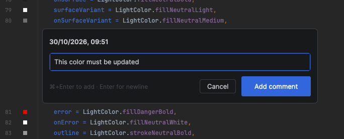

# Inline Notes

Offline inline review notes for IntelliJ-based IDEs. Source files stay untouched. [MIT licensed](LICENSE).



## Build and install

Configure a **JDK 25** for Gradle first. The first build downloads the pinned IntelliJ IDEA **2026.2.1** SDK with its bundled JBR into caches; no installed IDE is required. Expect a large download.

```bash
./gradlew buildPlugin
```

Install `build/distributions/inline-notes.zip` via **Settings → Plugins → Install Plugin from Disk**.

## Use

- Hover the gutter, then click its bubble to add. Existing bubbles hide/show notes.
- Edit inline. **Cmd/Ctrl+Enter** saves; **Escape** cancels. Use the trash icon to delete.
- **View → Tool Windows → Inline Notes** opens the file tree, with actions to copy notes or clear all after confirmation. Clear all has no undo.

Experimental POC: newer IDEs are untested; anchoring after external edits is best-effort. Notes are plain text in `.idea/inline-notes.xml`—keep it private and review copied content before sharing with an AI service. This fresh identity/storage does not migrate data from earlier plugin identities.
